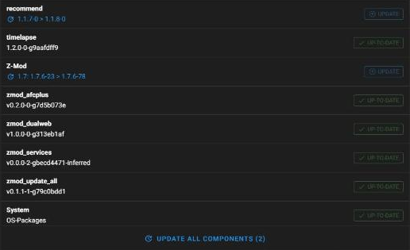
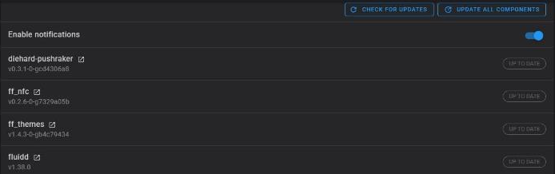

# zmod_update_all

> [!WARNING]
> **!!EXPERIMENTAL!! Use caution!** This plugin updates Z-Mod, Klipper,
> Moonraker and every plugin, and reboots the printer on its own, possibly
> more than once. It has only been tested on a few printers. Never run it
> while printing, keep a backup of your config, and be ready to power-cycle
> the printer if it does not come back.

An update queue for **Zmod** printers (Flashforge AD5X, Creator 5, AD5M).
One macro installs every available update and reboots as few times as
possible. You no longer click Update on each item and reboot after every one.

```
UPDATE_ALL            check, install every update, reboot when needed
UPDATE_ALL CHECK=1    only list the available updates
UPDATE_ALL REBOOT=0   plugins only, reboot yourself later
UPDATE_ALL CANCEL=1   drop a queue that is waiting for a reboot
```

Progress appears in the console (Fluidd, Mainsail, HelixScreen):

```
UPDATE_ALL: Checking for updates...
UPDATE_ALL: 4 update(s): fluidd v1.37.17 -> v1.37.18, ff_nfc v0.2.5 -> v0.2.6, moon 0.10.1-18 -> 0.10.1-19, Z-Mod 1.7.6-46 -> 1.7.6-55
UPDATE_ALL: moon, Z-Mod each reboot the printer by themselves. The queue carries on after each reboot.
UPDATE_ALL: Updating fluidd...
UPDATE_ALL: Updating ff_nfc...
UPDATE_ALL: Updating moon. The printer reboots afterwards and UPDATE_ALL carries on by itself.
   (reboot)
UPDATE_ALL: moon updated.
UPDATE_ALL: Resuming after the reboot, 1 left: Z-Mod
UPDATE_ALL: Updating Z-Mod. The printer reboots afterwards and UPDATE_ALL carries on by itself.
   (reboot)
UPDATE_ALL: Z-Mod updated.
UPDATE_ALL: Done. Updated 4: fluidd, ff_nfc, moon, Z-Mod.
```

## The Update all button

Zmod's Mainsail and Fluidd forks dropped their **UPDATE ALL COMPONENTS**
button. This plugin puts it back, in Mainsail's Update Manager panel and
next to **Check for updates** in Fluidd's Software Updates, and runs it
through the same queue as `UPDATE_ALL`:





The button shows how many updates the queue would install and hides when
there are none. It skips System/OS packages and broken repos, updates
plugins first, and resumes after each reboot. Progress shows in the update
dialog and in the console.

How it works, without changing any Zmod file:

- `update_all.py --inject` adds `web/zmod_update_all.js` to Mainsail's and
  Fluidd's `index.html` (and updates the page's revision in their service
  worker, so browsers do not keep the old cached page). A Mainsail or
  Fluidd update replaces those files, so the button is added again at
  every boot and right after each Mainsail/Fluidd update.
- The Moonraker component `moonraker/zmod_update_all.py` points
  Moonraker's full-update request (`machine.update.full`, and
  `machine.update.upgrade` without a name) at `update_all.py`. Stock
  Moonraker would run every updater in a row: it tries the OS packages,
  stops at the first repo with local changes, and is cut off when Zmod
  reboots after Z-Mod.

`install.sh` (run by `ENABLE_PLUGIN`) links the component into Moonraker's
components, includes `zmod_update_all.moonraker.conf` from
`mod_data/plugins.moonraker.conf`, adds the button and reboots once.
`DISABLE_PLUGIN` removes all of it and restores the web UI files.

## How many reboots

Zmod's Moonraker reboots the printer by itself straight after it updates
**Z-Mod**, **klippy** (Klipper) or **moon** (Moonraker). Some plugins ask
for a reboot from their own `update.sh` too (for example `recommend`, when
it applies new fixes). Nothing can stop those, so each can cost one
reboot. Other plugins and the web UIs do not reboot.

| Updates waiting | Reboots |
|---|---|
| plugins only | 1, at the end |
| plugins + Z-Mod | 1 (the Z-Mod reboot also loads the plugins) |
| plugins + klippy + moon + Z-Mod | 3 |
| a rebooting plugin (recommend) + Z-Mod | up to 2 |

You start it once; the reboots and the resume after each are automatic.

## What it does

1. Refuses to start while a print is running or while Moonraker is already
   updating something.
2. Asks Moonraker to check every update source (the same as **Refresh**).
3. Updates the plugins and web UIs first, one at a time, through Moonraker's
   normal update path. Plugin `update.sh` scripts still run.
4. Then the plugins whose `update.sh` can ask for a reboot (it writes
   `REBOOT` to `/tmp/printer` or calls `reboot`), then klippy, moon and
   Z-Mod, in that order, one at a time with a pause after each, so no
   update starts while a reboot is on its way.
5. The queue is saved to `/root/.zmod_update_all.json` in the chroot before
   every item. After any reboot, `_UPDATE_ALL_RESUME` (a `delayed_gcode` at
   Klipper start) waits for Moonraker and Klipper, checks the item really
   updated, and carries on.
6. Skips items it cannot update safely (local changes, an invalid or corrupt
   repo, a detached HEAD) and says why. Fix those from the update panel
   (Recover), then run `UPDATE_ALL` again.
7. Keeps going if one item fails, and lists the failures at the end. An item
   that is still out of date after a reboot is tried once more (the reboot
   may have come from something else); after that it is left out, so a bad
   update cannot cause a reboot loop.
8. Stops if a print starts. After a reboot it waits until Moonraker's own
   startup refresh is done before checking versions. A queue is resumed
   at most 6 times, then dropped.
9. Reboots once with Zmod's `REBOOT` macro at the end, only if something was
   updated since the last reboot.

The work runs in the background inside Zmod's chroot, so Klipper stays
responsive. Full log: `mod_data/log/zmod_update_all.log` in the printer's config
folder (Fluidd/Mainsail show it), kept across the reboots.

## Install

Add this to `mod_data/user.moonraker.conf`:

```ini
[update_manager zmod_update_all]
type: git_repo
channel: stable
path: /root/printer_data/config/mod_data/plugins/zmod_update_all
origin: https://github.com/DIEHARDave/zmod_update_all.git
is_system_service: False
primary_branch: main
```

Then run `ENABLE_PLUGIN name=zmod_update_all` in the console.

## Uninstall

`DISABLE_PLUGIN name=zmod_update_all`, then remove the section from
`user.moonraker.conf`.

## Testing over SSH

```sh
chroot /usr/data/.mod/.zmod python3 \
    /root/printer_data/config/mod_data/plugins/zmod_update_all/update_all.py \
    --check --foreground
```

## License

GPLv3. See [LICENSE](LICENSE).
